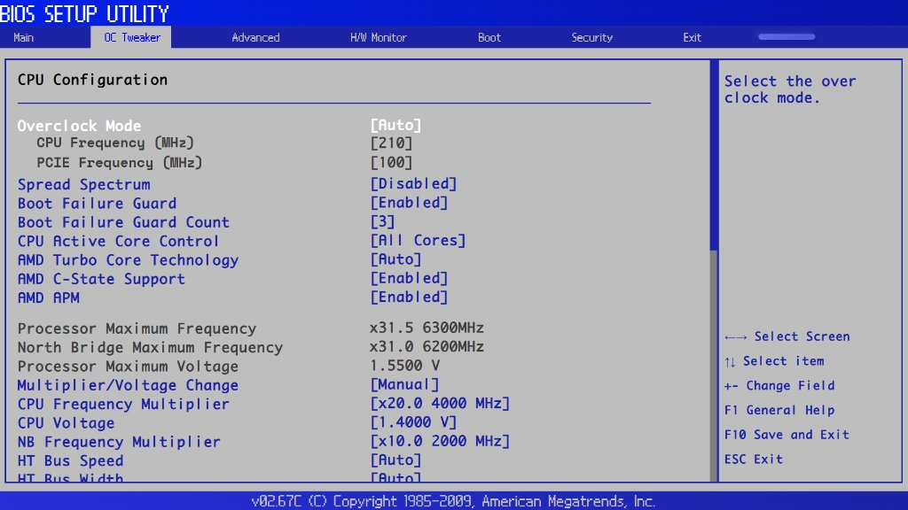

# Інтерактивний веб-емулятор BIOS (AMIBIOS Setup Utility)

> **Дипломна робота для НФК Ніжина (Ніжинський фаховий коледж)**

Інтерактивний веб-тренажер та емулятор класичного **AMIBIOS (ASRock 760GM-HDV, AMD FX-8320)** із системою навчальних завдань, PvP-дуелями, локальною базою даних SQLite, панеллю адміністратора та сучасною системою авторизації.



---

## Основні можливості

- **Реалістичний інтерфейс BIOS (AMIBIOS)** — автентичний POST-екран, шрифти, звуковий супровід та повне керування з клавіатури (`↑ ↓ ← →`, `Enter`, `Tab`, `+ / -`, `F1`, `F2 / Del`, `F6`, `F9`, `F10`, `ESC`).
- **Всі ключові розділи BIOS**:
  - `Main` — системний час, дата, інформація про процесор, кеш та оперативну пам'ять;
  - `OC Tweaker` — налаштування частот, множників, напруги, активних ядер та підменю **Memory Timing** (14 параметрів таймінгів DDR3);
  - `Advanced` — конфігурація CPU, Chipset, ACPI, Storage (SATA), PCIPnP, USB та утиліта **Instant Flash** із підтримкою **WebUSB API**;
  - `H/W Monitor` — динамічний моніторинг температур, напруг та керування вентиляторами;
  - `Boot` — порядок завантаження пристроїв та параметри завантаження;
  - `Security` — встановлення паролів користувача та адміністратора BIOS;
  - `Exit` — збереження, скидання до оптимальних налаштувань та перезапуск.
- **Навчальна система завдань** — вбудований каталог практичних завдань із автоматичною перевіркою виконання.
- **PvP-дуелі** — режим змагань між користувачами на швидкість та точність налаштування BIOS.
- **Панель адміністратора (`admin_panel.html`)** — керування користувачами, завданнями, статистикою та журналом аудиту.
- **Безпека та база даних**:
  - Локальна база даних **SQLite 3** (`data/userdata.sqlite`, створюється автоматично);
  - Хешування паролів алгоритмом **Argon2id**;
  - Захист від CSRF, SQL-ін'єкцій, XSS та брутфорсу (rate limiting).

---

## Вимоги для запуску

- **PHP 8.0 або вище** (підійде також пакет **XAMPP** або **OSPanel**)
- Увімкнені розширення PHP:
  - `pdo_sqlite`
  - `openssl`
  - `mbstring`
- Сучасний веб-браузер (Chrome, Edge, Firefox)

---

## Встановлення та налаштування

### 1. Клонування репозиторію

```bash
git clone https://github.com/Magforo/bios-emulator-nfk.git
cd bios-emulator-nfk
```

### 2. Ініціалізація бази даних та системи безпеки

База даних SQLite (`data/userdata.sqlite`) та службові журнали не зберігаються у репозиторії з міркувань безпеки. Для їх автоматичного створення виконайте один раз команду:

```bash
php init_security.php
```

Цей скрипт автоматично створить директорії `data/` та `security_logs/`, а також ініціалізує всі необхідні таблиці у `data/userdata.sqlite`.

> **Примітка:** переконайтеся, що у файлі `php.ini` розкоментовано рядки:
> ```ini
> extension=pdo_sqlite
> extension=openssl
> extension=mbstring
> ```

---

## Запуск проєкту локально

### Варіант 1: Через вбудований сервер PHP (найшвидший спосіб)

У кореневій папці проєкту виконайте:

```bash
php -S localhost:8000
```

Після цього відкрийте у браузері:
- **Головна сторінка (вхід / реєстрація):** http://localhost:8000/
- **Емулятор BIOS:** http://localhost:8000/bios.html
- **Панель адміністратора:** http://localhost:8000/admin_panel.html

> **Важливо:** відкривайте сайт саме за адресою `http://localhost:8000` (а не `127.0.0.1`), оскільки перевірка локального середовища в обробниках авторизації орієнтується на хост `localhost`.

### Варіант 2: Через XAMPP

1. Скопіюйте папку проєкту в директорію `xampp/htdocs/xampp_bios`.
2. Запустіть модуль **Apache** у XAMPP Control Panel.
3. Відкрийте у браузері http://localhost/xampp_bios/init_security.php для ініціалізації бази даних.
4. Перейдіть на http://localhost/xampp_bios/loginandreg.html.

---

## Керування в емуляторі BIOS

| Клавіша | Дія |
| :--- | :--- |
| `←` `→` | Перемикання між вкладками верхнього меню |
| `↑` `↓` | Навігація по пунктах меню |
| `Enter` | Відкрити підменю або вікно вибору параметра |
| `+` / `-` | Зміна значення параметра |
| `Tab` | Перемикання полів (час / дата) |
| `F1` | Загальна довідка (General Help) |
| `F9` | Завантажити оптимальні налаштування |
| `F10` | Зберегти зміни та вийти |
| `ESC` | Повернутися назад / закрити вікно |
